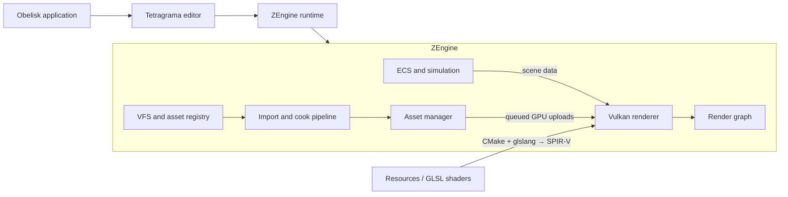

# Architecture

ZEngine is a cross-platform C++20 engine built around a Vulkan renderer. This
document gives a repository-level map of its runtime and tools; the
[architecture reference](docs/reference/architecture.md) and
[rendering reference](docs/reference/rendering.md) describe implementation
details.

## Repository components

| Path | Responsibility |
|---|---|
| `ZEngine/ZEngine` | Runtime library: core services, memory, VFS, ECS, asset cooking and importing, input, UI, platform integration, and rendering. |
| `Tetragrama` | Native editor built on the engine library. Its tests live in `Tetragrama/tests`. |
| `Obelisk` | Application entry point that links the editor and engine libraries. |
| `Resources` | Runtime settings and GLSL shader sources. CMake compiles shaders to SPIR-V and stages runtime resources. |
| `ZEngine/tests` | Engine unit, integration, and process-level tests. |
| `Scripts` | Build, formatting, release, and scene-evidence tooling. |

The root `CMakeLists.txt` configures resources, the engine, the editor, and the
application in that order. `dependencies.cmake` declares third-party libraries
and exposes their targets to the engine build.

## Runtime shape

The engine separates simulation and editor work from GPU command recording.
The main thread owns ECS state, input, and UI logic. A render thread records and
submits Vulkan work. Background workers handle tasks such as asset import;
they enqueue GPU uploads for the render thread instead of issuing Vulkan
commands themselves.

## Major subsystems

- **Core services** in `ZEngine/ZEngine/Core` provide containers, memory
  management, serialization, scheduling, and the virtual file system.
- **ECS and scenes** in `ZEngine/ZEngine/ECS` manage entities, components,
  scene state, and scheduled world updates.
- **Asset processing** uses the VFS, importers, codecs, and the cook subsystem
  to discover and prepare assets. Runtime CPU asset ownership is separate from
  GPU resource lifetime.
- **Rendering** in `ZEngine/ZEngine/Rendering` uses Vulkan, a render graph,
  explicit render passes, and `RenderResourceManager` for GPU resource
  lifetime. The render thread drains queued uploads.
- **Editor UI** is provided by Tetragrama and the engine's ZUI system.

## Build and test boundaries

The root CMake project uses C++20 and CMake presets for Windows x64, macOS x64
and arm64, and Linux x64. `ZEngineTests` and `TetragramaTests` cover runtime
and editor behavior; additional process-level tests exercise scene and cook
flows. See [Requirements](requirements.md) and the [CI workflow](workflow.md)
for build and validation details.

## Detailed references

- [Engine architecture](docs/reference/architecture.md)
- [Rendering domain](docs/reference/rendering.md)
- [Asset pipeline](docs/reference/asset-pipeline.md)
- [Memory management](docs/reference/memory-management.md)
- [ZUI system](docs/reference/zui.md)
